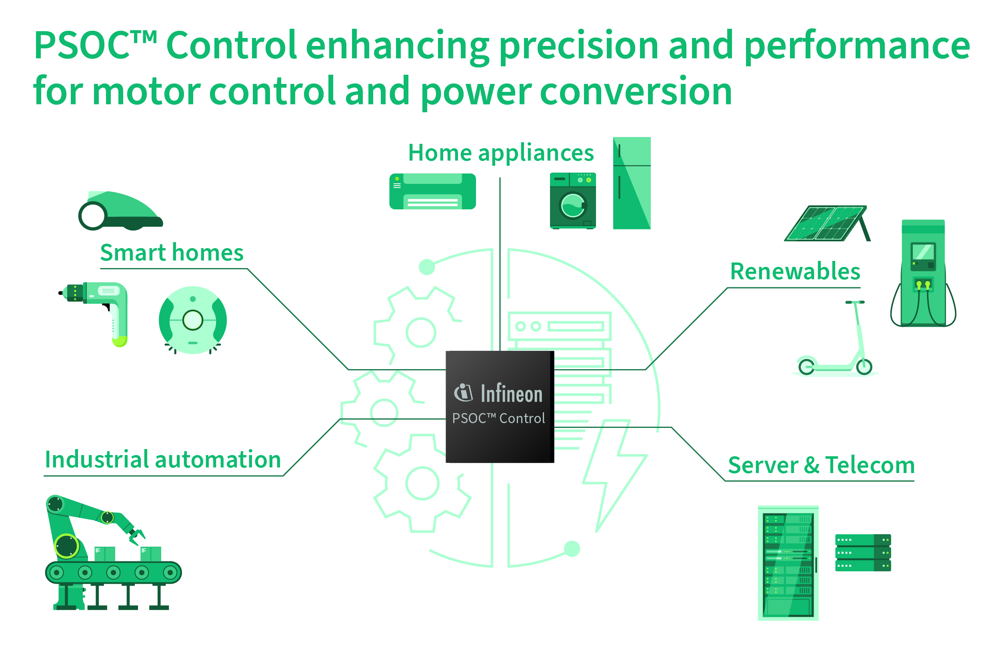

# PSOC™ Control Main / Entry Line Training

Build your way from a first look at the PSOC™ Control C3 main and entry line to focused, hands-on development. Use this training to learn the fundamentals of the platform and progress to more advanced topics, such as security, functional safety, and motor control.

<p align="center"></p>

## Access the training material

There are two ways to get the training material:

- **Open a single training:** Select any course link on this page to open that training on Infineon GitHub. No cloning is needed.
- **Get everything:** Clone this repository with submodules to download all courses under `courses/` at once:

  ```sh
  git clone --recurse-submodules https://github.com/Infineon/psoc-training-control-c3-entry-main.git
  ```

  If you already cloned it without submodules, initialize them with:

  ```sh
  git submodule update --init --recursive
  ```

## Get started

Start with the PSOC™ Control C3 M5/P5 training. It assumes basic ModusToolbox™ knowledge.

[PSOC™ Control C3 M5/P5 training](https://github.com/Infineon/mtb-training-psoc-control-c3m5-c3p5) — Introduces the PSOC™ Control C3 M5/P5 platform through 12 sessions covering its applications, architecture, peripherals, power, security, safety, and motor control. Uses the KIT_PSC3M5_EVK.

1. Platform introduction
2. Top applications and use cases
3. Core architecture and memory: CPU, interrupts, and clocks
4. I/O and serial connectivity
5. Timers and analog subsystems
6. CORDIC math accelerator
7. Power management strategies
8. Middlewares and EEPROM setup
9. Security, boot, and IPC
10. Functional Safety Test Library (STL)
11. IDE workflows for Keil, IAR, and ModusToolbox™
12. Motor control fundamentals


## Training index

Browse the [ModusToolbox™ training page](https://github.com/Infineon/training-modustoolbox) for PSOC™ and other device training.
